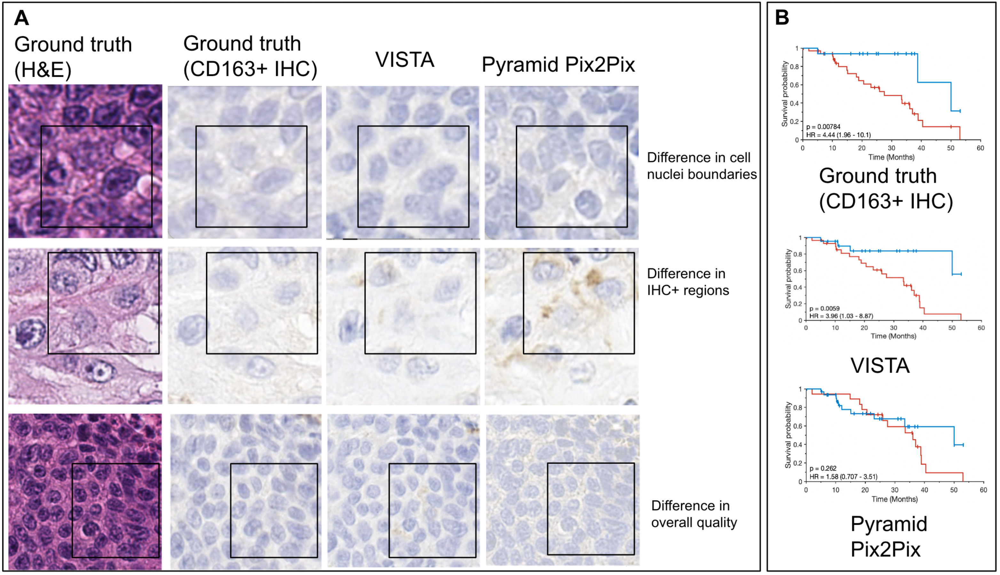
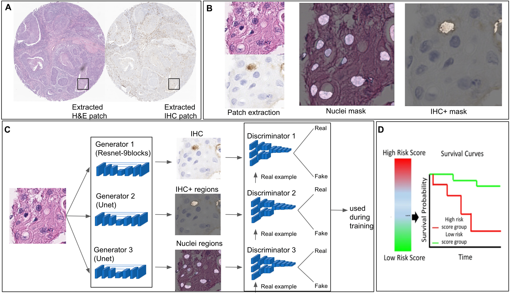

# VISTA: A Virtual Staining Framework for Translating Hematoxylin and Eosin-Stain into Immunohistochemistry-Stain Images

---

## Abstract
Virtual staining is a deep learning-based approach that facilitates the transformation of digital pathology images of one stain (e.g. Hematoxylin and Eosin (H\&E)) to a different one. Current virtual staining methods, including the state-of-the-art method Pyramid Pix2Pix, face challenges in preserving cell nuclei boundaries and immunohistochemistry (IHC)-positive regions when translating samples from H\&E to IHC. Here, we introduce VISTA, a general-purpose computational virtual staining framework designed to translate H\&E into IHC images and address previous challenges through a novel loss function. This loss function is pivotal to the success of VISTA as it simultaneously optimizes three key tasks: generating IHC images, segmenting IHC-positive regions, and segmenting nuclei. To evaluate the efficacy of VISTA, we focus on simulating a particular biomarker derived from the generated IHC images for a specific cancer type. We concentrate on the challenging task of identifying tumor-associated macrophages (TAMs) in H\&E images, wherein pathologists rely on IHC images for accurate TAM identification. To achieve this, we utilized co-registered CD163+ IHC and H\&E images from 152 patients with HPV-associated oropharyngeal squamous cell carcinoma. For training VISTA, we employed data from 102 patients treated at ******* (T1), and for testing, data from 50 patients treated at ******* (T2). VISTA significantly improves the quality of the generated CD163+ IHC images in T2 (SSIM=0.72, PSNR=20.8) compared to Pyramid Pix2Pix (SSIM=0.67, PSNR=19.8). Furthermore, the TAM index derived from VISTA is the only one that is significantly associated with survival outcomes in T2 (p-value=0.006, Hazard Ratio=3.96 [1.03-8.87]) compared to Pyramid Pix2Pix (p-value=0.26, Hazard Ratio=1.58 [0.71-3.51]). Our results demonstrate that VISTA could serve as a computational surrogate for IHC image generation from H\&E images and be used for simulating other biomarkers from routine pathology images.

## Authors
Arpit Aggarwal, German Corredor, and Anant Madabhushi  

## Prerequisites
1. Python 3.8

## Packages Required
The packages required for running this code are Matlab, PyTorch, PIL, OpenCV, Numpy. 

## Workflow for TAM identification

## Preparing training dataset
For training, all images should be of size 256x256 and combined together in 2048x512 images (4 images of size 256x256 (H&E, IHC, IHC+ binary segmentation, Nuclei binary segmentation)). Similar should be done for validation dataset. Important to note, nuclei masks were obtained using pretrained Hovernet model on Pannuke dataset and IHC+ binary segmentation was obtained using image preprocessing steps.

## Training model
python3 train.py --dataroot 'dataset_path' --name 'model_name' --model pix2pix